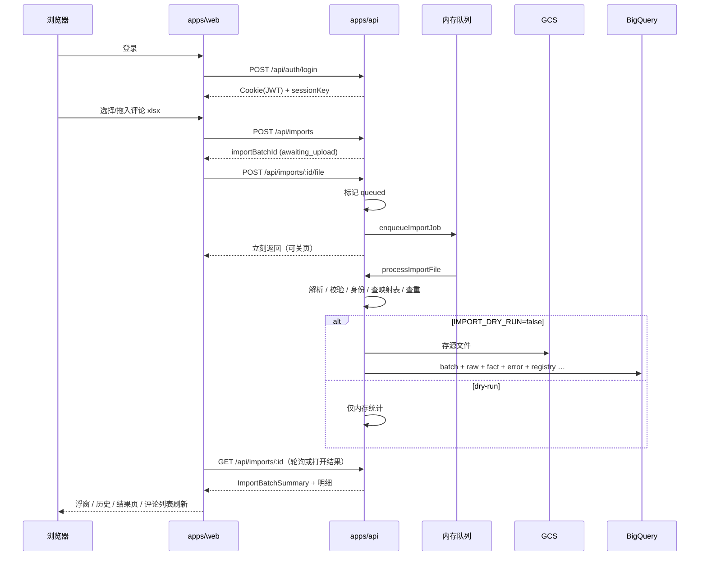
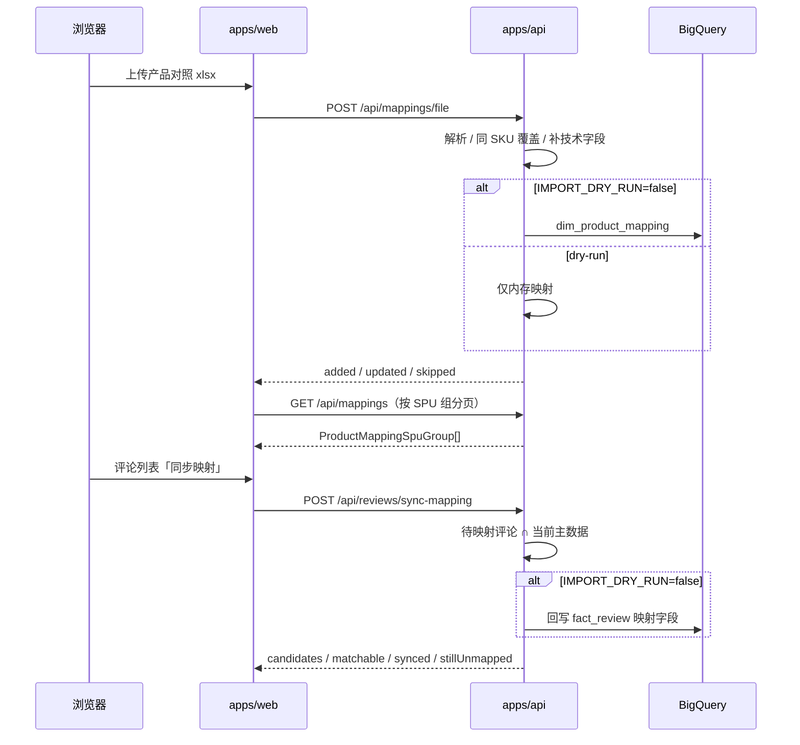

# Feimei VOC 应用 — 技术栈、作用与依赖说明

> 面向「现在仓库里实际做了什么」的产品/工程说明。  
> 方案与字段字典仍见：`docs/产品评论与差评分析系统方案 (2).md`、`docs/统一评论字段字典 v1.0.md`。  
> 映射细则与模板约定见：`docs/products/产品映射实施说明.md`。

更新时间：2026-09-17

---

## 1. 这个项目是干什么的

**一句话：** 把多品牌、多平台的产品/店铺评论 Excel，经工作台上传后，标准化写入 Google BigQuery；并用内部 SKU 主数据把评论上的平台货号映射到公司货号（阶段一：导入 + 产品映射工作台；差评分析看板后续再做）。

| 角色 | 做什么 |
|------|--------|
| 业务同学 | 登录 → 先维护产品主数据（可选）→ 下载评论模板填表 → 上传 xlsx → 在任务浮窗/历史上传/评论列表看进度与映射结果 |
| 后端 API | 鉴权、解析 Excel、算 review_id、查重、写 GCS 原件 + BQ Raw/Core/Control；主数据写入与评论匹配 / 历史回写 |
| BigQuery | 存评论事实、产品映射维表与导入批次；Serving 视图给后续看板读「当前有效评论」 |
| 前端 | 不持有 GCP 密钥；只拿会话 Cookie + 可选的会话层加密密钥 |

### 阶段一结论：**已完成（评论导入 + 产品映射闭环）**

阶段一目标是「评论能进库、主数据能维护、映射能命中、结果能回看、环境可干跑可写真库」。下列能力已在仓库落地，可作为阶段一交付基线。

| 范围 | 状态 |
|------|------|
| 登录（`.env` 账号）+ 会话 Cookie / CSRF / 可选 AES 包体；401 回登录页 | ✅ |
| 侧栏大类：**评论**（导入 / 列表 / 历史）+ **产品**（导入 / 列表）；`/` → `/imports` | ✅ |
| 评论导入页（步骤条、拖拽上传、模板下载） | ✅ |
| 后台异步导入 + 右下角任务浮窗（本会话） | ✅ |
| 上传历史列表 + 批次结果页（统计 + 隔离/重复明细） | ✅ |
| 评论列表（分页筛选、是否映射、同步映射） | ✅ |
| 产品导入（对照表上传）+ 产品列表（按 SPU 合并行、展开收起 SKU） | ✅ |
| 评论导入自动匹配主数据；补表后「同步映射」回写历史 pending | ✅ |
| 工作台多页签 keep-alive；列表刷新保留旧行 + loading | ✅ |
| Excel 解析、校验隔离、身份、查重、写 GCS/BQ | ✅ |
| 干跑 / 写真库开关；孤儿任务自动标失败 | ✅ |
| BigQuery DDL（control/raw/core/serving）+ 清空重建脚本 | ✅ |
| 前后端共享契约与文案字典 `@voc/shared` | ✅ |

**阶段一不做（留给后续）：** 差评主题分析 UI、Google 登录 / Firestore 权限、媒体异步下载完整流水线、API 与 Worker 分进程部署、钉钉通知、待映射清单里的单条人工确认。

**产品映射（H02）状态：** P0（上传 / 列表 / 导入时匹配）已完成；P1「补对照表后回写历史评论」已通过评论列表「同步映射」落地。未做：待映射队列里单条人工确认。

---

## 2. 仓库长什么样

```
fm-voc-system/
├── apps/web                 # React 前端（Vite）
│   └── public/templates/    # 评论导入 + 产品对照模板 xlsx
├── apps/api                 # Node Fastify API（鉴权 + 导入 + 映射）
├── packages/shared          # 模板列名、类型、版本常量、界面文案字典
├── sql/ddl                  # BigQuery 建表/视图（base_tables.sql）
├── sql/ops                  # 运维：clear_import_data.sql 等
├── docs/                    # 方案、字段字典、本文档
└── docs/templates/          # 额外样例/主数据模板（可选）
```

根目录是 **npm workspaces** 单体仓：一次 `npm install`，用 `-w @voc/api` / `@voc/web` / `@voc/shared` 分别开发。

---

## 3. 技术栈总览

| 层 | 技术 | 作用 |
|----|------|------|
| 运行时 | Node.js ≥ 20 | API 与构建脚本 |
| 语言 | TypeScript | 前后端与 shared 包 |
| 前端 | React 19 + React Router 7 + Vite 6 + **shadcn/ui + Tailwind CSS** | SPA：登录 / 评论导入·列表·历史 / 产品导入·列表；响应式桌面/移动端 |
| 后端 | Fastify 5 | HTTP API、Cookie、CORS、multipart 上传 |
| 共享包 | `@voc/shared` | 列名契约、Import/Mapping 状态、文案字典、列表分页类型、加密信封类型 |
| 表格解析 | ExcelJS | 读评论 `.xlsx`（`01_评论导入`）与产品对照（`01_内部SKU主数据`） |
| 云数据 | BigQuery + GCS | 评论事实与源文件归档（干跑时可关） |
| 鉴权 | jose（JWT）+ HttpOnly Cookie | 登录会话；CSRF 配套 |
| 会话体加密 | Web Crypto / Node crypto AES-GCM | 敏感 JSON 可选加密（不放 BQ 密钥） |
| 部署形态 | Docker → 计划 Cloud Run | `apps/*/Dockerfile` 已备 |

**数据分层（GCP 项目 `feimei-product-voc`）：**

| Dataset | 作用 |
|---------|------|
| `review_control` | 导入批次、错误、查重索引 `source_row_hash_registry`、发布门闩 |
| `review_raw` | 每行原始 payload |
| `review_core` | `fact_review` 等事实与映射维表 |
| `review_serving` | `v_review_current` / `v_review_media` 视图（读侧） |
| `review_semantic` | 阶段一不建业务表（主题等留给二期） |

---

## 4. 阶段一已实现功能点

### 4.1 前端（`apps/web`）

| 页面/能力 | 说明 |
|-----------|------|
| 登录页 | 用户名密码登录；拿到 `sessionKey`；会话失效（401）自动回登录，可带 `?next=` 回原页 |
| 侧栏导航 | 大类 **评论**（首位）/ **产品**，可收展；`/` 默认跳转 `/imports`；旧路径 `/mapping` → `/products/import` |
| 评论导入页 | 步骤条 + 拖拽/选择 xlsx + **下载规范模板**；创建批次 → 上传 → 后台处理（不阻塞页签） |
| 评论列表 | 统一分页筛选（品牌/地区/星级/是否映射/关键词）；映射状态色标；无平台 SKU 显示 `-` 而非「未映射」；**同步映射**按钮 + 结果弹窗 |
| 上传历史 | 批次列表（状态、行数统计）；处理中轮询；点击打开结果页签 |
| 批次结果页 | 状态徽章、总行/成功/隔离/待映射/无正文/重复；隔离与重复明细（桌面表 / 移动卡片，虚拟列表） |
| 产品导入页 | 下载对照模板、拖拽上传 xlsx；成功后通知产品列表刷新 |
| 产品列表 | 当前有效主数据；按 **品牌+SPU** 表格 `rowSpan` 合并；SKU 默认折叠（可展开）；中/英文名分列；分页按 SPU 组计数 |
| 任务浮窗 | 仅展示**本浏览器会话**上传过的批次；完成后 toast；可跳转结果/历史；并刷新评论列表 |
| 工作台页签 | 评论导入 / 评论列表 / 历史 / 产品导入 / 产品列表 / 多结果 keep-alive；定点 `notifyPageRefresh` |
| 列表体验 | 筛选折叠面板（桌面 Popover / 移动 Sheet）；刷新保留旧行 + 半透明 loading |
| 路由守卫 | `/api/auth/me` 失败则回登录；任意 API `401` 清会话并跳转登录 |
| API 客户端 | `credentials: 'include'`；可选 `x-voc-encrypted: 1` 包一层 AES-GCM（仅 JSON body） |

**刻意没有的：** 品牌/平台下拉（行内自带，支持混导）、BQ 配置、密钥输入。

### 4.2 后端（`apps/api`）

| 接口 | 作用 |
|------|------|
| `GET /api/health` | 健康检查；是否 dry-run、项目 ID |
| `POST /api/auth/login` | 校验账号 → 发 JWT Cookie + 返回 `sessionKey` |
| `POST /api/auth/logout` | 清 Cookie |
| `GET /api/auth/me` | 当前用户 |
| `GET /api/imports` | 历史上传列表（最新状态投影；含孤儿任务修复） |
| `POST /api/imports` | 创建导入批次壳（幂等键 + 文件名） |
| `POST /api/imports/:id/file` | multipart 上传 xlsx（≤20MiB），标记 `queued` 后立刻返回，后台处理 |
| `GET /api/imports/:id` | 查批次摘要（含隔离/重复明细回填；含孤儿修复） |
| `GET /api/reviews` | 评论列表（统一 `page/pageSize/q` + 品牌/地区/星级/是否映射） |
| `POST /api/reviews/sync-mapping` | 把有平台 SKU 且未 confirmed 的历史评论按当前主数据回写为已映射 |
| `GET /api/mappings` | 当前有效内部 SKU；**按 SPU 分组合页**返回 `ProductMappingSpuGroup[]` |
| `GET /api/mappings/unmapped` | 待映射/冲突的 `(brand_key, platform_sku)` 聚合 |
| `POST /api/mappings/file` | 上传对照 xlsx → 校验 → 写入 `dim_product_mapping`（同 SKU 覆盖） |

列表类接口统一走 `parseListQuery` / `PaginatedListResponse`（见 `@voc/shared` 的 `list.ts`）。

### 4.3 导入流水线（核心逻辑）

1. **接收入队**：上传后 `queued` → 进程内 `enqueueImportJob` 异步跑（浏览器断开不影响；**API 进程重启会丢未跑完任务**，读详情时会标为失败）。  
2. **解析** Excel：优先 Sheet `01_评论导入` / 名含「评论」；校验表头；跳过表头与提示行。  
3. **校验隔离**：缺 platform/brand、坏评分、坏日期等 → quarantine，写入 `review_import_error`，不进 Core 成功路径。  
4. **身份**：有 `source_review_id` → `native_id`；否则内容指纹 `fingerprint_v1`；弱身份（无正文/标题/平台 ID/媒体）用批次+行号区分 `review_id`。  
5. **范围与映射**：`platform_sku` 空 → `review_scope=store`（不计入待映射）；否则 `product`。写 Core 前按 `brand_key + platform_sku` 查 `dim_product_mapping`（规则 `global_sku_v1`，匹配 `alias_value`/`internal_sku`）；命中 → `confirmed` + 内部字段，**不**计入 unmapped；未命中 → `pending` 计入 unmapped。  
6. **查重**：有正文/标题/`source_review_id`/媒体时，用 `source_row_hash` 做**文件内 + 历史库**查重；弱身份**跳过查重**以免星评误杀。重复行写入 `review_import_error`（stage=`dedup`）。  
7. **写入**（`IMPORT_DRY_RUN=false`）：GCS 源文件 + BQ `review_import_batch`（状态追加投影）/ raw / fact / observation / error / `source_row_hash_registry`。  
8. **干跑**（`true`）：逻辑相同但不写云；历史查重与映射只查本进程内存。  
9. **结果回看**：批次计数在 `review_import_batch`；隔离/重复明细从 `review_import_error` 回填（旧格式会尝试用 raw 补品牌/评论内容）。

### 4.4 产品映射流水线

1. **上传对照表**（`POST /api/mappings/file`）：解析 `01_内部SKU主数据`（兼容旧表 `01_产品SKU对照` 的 `alias_value`→`internal_sku`）；跳过示例行。  
2. **向前填充**：仅 `brand_key` / `internal_spu` 整表向前填（合并单元格）；**产品名仅在同一 SPU 内**向前填，避免把上一产品的英文名串到下一产品。  
3. **写入维表**：自动补 `platform='*'`、`alias_type=seller_sku`、`alias_value=internal_sku`、`mapping_rule_version=global_sku_v1` 等；同 `brand_key+internal_sku` **覆盖**；本次未出现的旧 SKU **保留**。  
4. **评论导入时匹配**：见 §4.3 第 5 步。  
5. **同步映射（历史回写）**：`POST /api/reviews/sync-mapping` 选出「有平台 SKU 且非 confirmed」的评论，按当前主数据 `brand_key+platform_sku` 命中则回写内部字段与 `confirmed`；返回 `candidates` / `matchable` / `synced` / `stillUnmapped`（干跑时只统计不写库）。  
6. **产品列表**：拉取有效 SKU 后按品牌+SPU 分组再分页；前端用表格 `rowSpan` 合并品牌/SPU/名称/粒度，SKU 可折叠展开。

干跑与写真库同样遵守 `IMPORT_DRY_RUN`（映射上传与同步映射都不例外）。写真库时请勿用测试前缀随意灌数（见 `.cursor/rules/import-dry-run-safety.mdc`）。

### 4.5 运行时身份：现状 vs 上线目标（规划用）

GCP 已准备**两套**服务账号（见 `docs/gcp-bootstrap.md`），但**当前代码仍是单体 API**：

| | 现状（阶段一） | 目标（权限收紧时） |
|--|--|--|
| 进程 | 仅 `apps/api`：读列表 + 上传写库同一进程 | API（读）+ Worker/Job（写）可拆开 |
| 队列 | 进程内 `enqueueImportJob`（内存） | 持久队列 / Cloud Run Job（可选） |
| 凭证 | 一份 `GOOGLE_APPLICATION_CREDENTIALS`，用 **Worker** JSON 即可 | API 挂 `review-api-runtime`；写任务挂 `review-worker-runtime` |
| 前端 | 同一个 `apps/web` | **不变** |

阶段一交付**不要求**拆进程；本地/先上线用 Worker 账号写真库即可。

### 4.6 与方案的对应关系

| 方案能力 | 阶段一现状 |
|----------|------------|
| 历史评论进 BQ | ✅ 导入路径已通（关 dry-run + 可写 SA） |
| 文件内 + 库内 hash 查重 | ✅ registry；弱身份跳过查重 |
| 批次结果可回看（含明细） | ✅ 计数 + `review_import_error` 回填 |
| Serving 当前评论视图 | ✅ SQL 已建；写 Core 后视图可见（暂无看板消费） |
| SKU 对照表维护 UI | ✅ 产品导入 + 产品列表（按 SPU 合并） |
| 评论导入自动匹配 | ✅ `brand_key + platform_sku` → 主数据 |
| 补映射后回写历史评论 | ✅ 评论列表「同步映射」 |
| 待映射清单 API | ✅ `GET /api/mappings/unmapped`（UI 已从早期单页拆出，以列表/批次待映射为主） |
| 单条人工确认 | ❌ |
| 差评主题 / 语义层 | ❌ |
| 媒体异步归档 | ❌ 仅解析字段；`media_status=not_started` |
| API / Worker 身份分离部署 | 📄 文档有；代码仍为单体 |
| Google 登录 / Firestore 权限 | ❌（现用 `.env` 账号） |
| `import_publication` 门闩写路径 | 📄 DDL/种子有；导入代码未走 publication |

### 4.7 阶段一验收建议（手工）

1. `IMPORT_DRY_RUN=true`：上传评论样例 → 浮窗进度 → 历史/结果页计数合理。  
2. 产品导入：上传对照表 → 产品列表按 SPU 合并可见；再导带 `platform_sku` 的评论 → 命中为「已映射」、未命中为「未映射」。  
3. 同步映射：补主数据后点「同步映射」→ `matchable`/`synced` 合理；评论列表状态更新。  
4. `IMPORT_DRY_RUN=false` + Worker SA：同上，并在 BQ 看到 batch / raw / fact / `dim_product_mapping` / registry / error。  
5. 刷新结果页：隔离/重复明细仍在（非仅内存）。  
6. 导入中重启 API：卡住的 `queued`/`running` 在再次打开详情/历史时变为失败提示。  
7. 会话过期或清 Cookie：任意操作应回到登录页。  
8. 清空库：先 `sql/ops/clear_import_data.sql`，再跑 `sql/ddl/base_tables.sql`。

---

## 5. 依赖说明（直接依赖）

只列 `package.json` 里声明的；`node_modules` 里间接依赖不逐条展开。

### 5.1 根 / Shared

| 包 | 用途 |
|----|------|
| `typescript` | 编译 TS |
| npm workspaces | 把 `apps/*`、`packages/*` 绑成一个仓库 |

`@voc/shared` **无运行时依赖**：模板列、版本常量、导入/映射状态、列表分页类型、**文案字典**（`labels.ts`：状态/问题码/结果页/导入页/映射页/评论列表文案）。

### 5.2 API（`apps/api`）

| 包 | 干什么 |
|----|--------|
| `fastify` | Web 框架：路由、插件、JSON body |
| `@fastify/cookie` | 读写 HttpOnly 会话 Cookie |
| `@fastify/cors` | 允许本地 Vite 源带 Cookie 跨域 |
| `@fastify/multipart` | 接收上传的 xlsx |
| `jose` | 签发/校验 JWT |
| `exceljs` | 解析 Excel |
| `@google-cloud/bigquery` | 写入/查询 BigQuery |
| `@google-cloud/storage` | 上传源文件到 raw bucket |
| `dotenv` | 加载 `apps/api/.env` |
| `uuid` | 生成 `import_batch_id` 等 |
| `@voc/shared` | 与前端对齐的契约 |
| `tsx`（dev） | 本地热重载 |
| `@types/node`（dev） | Node 类型 |

### 5.3 Web（`apps/web`）

| 包 | 干什么 |
|----|--------|
| `react` / `react-dom` | UI |
| `react-router-dom` | `/login`、`/imports`、`/reviews`、`/history`、`/imports/:id`、`/products/import`、`/products/list` |
| `@tanstack/react-virtual` | 结果页明细虚拟列表 |
| `lucide-react` | 图标 |
| `@voc/shared` | 类型与文案 |
| `vite` / `@vitejs/plugin-react`（dev） | 开发与打包 |

前端**没有** BigQuery / GCS SDK——刻意的。

---

## 6. 关键环境变量（API）

| 变量 | 作用 |
|------|------|
| `AUTH_USERNAME` / `AUTH_PASSWORD` | 开发登录账号（上线应换 Secret） |
| `JWT_SECRET` | 签 JWT |
| `SESSION_CRYPTO_SECRET` | 派生会话 AES 密钥 |
| `COOKIE_SECURE` | 生产 HTTPS 下设 `true` |
| `CORS_ORIGIN` | 允许的前端 Origin |
| `GCP_PROJECT_ID` | 默认 `feimei-product-voc` |
| `GCS_RAW_BUCKET` | 源文件桶 |
| `IMPORT_DRY_RUN` | `true`=不写云；`false`=写 BQ/GCS |
| `PORT` / `HOST` | API 监听 |
| `GOOGLE_APPLICATION_CREDENTIALS` | 本地指向可写 SA JSON（`review-worker-runtime`）；**勿提交仓库** |

---

## 7. 本地怎么跑（速查）

```bash
npm install
npm run build -w @voc/shared
npm run dev          # 或分别：dev:api + dev:web
# API  http://127.0.0.1:8787
# Web  http://127.0.0.1:5173
```

默认账号：`admin` / `123456`（仅开发）。  
浏览器下载模板：评论导入页 → `voc_review_import_template.xlsx`；产品导入页 → `voc_product_mapping_template.xlsx`。

BigQuery 初始化：`sql/README.md`（跑 `ddl/base_tables.sql`）。清空再重建：`sql/ops/clear_import_data.sql` → 再跑 DDL。

更完整的运维说明见仓库根目录 `README.md`。

---

## 8. 请求生命周期（便于理解「做了啥」）

### 8.1 评论导入



### 8.2 产品导入与同步映射



Serving 视图**不需要**导入后再同步：查 `review_serving.v_review_current` 即看到 Core 里当前有效版本。

---

## 9. 代码从哪读起

| 想了解 | 打开 |
|--------|------|
| 有哪些 API | `apps/api/src/routes.ts` |
| 登录与 Cookie | `apps/api/src/auth.ts` |
| 会话加密 | `apps/api/src/crypto.ts` |
| 导入主流程 | `apps/api/src/import/service.ts` |
| 产品映射上传 / 匹配 / 列表分组 | `apps/api/src/mapping/`（parse / service / store） |
| 评论列表 / 同步映射 | `apps/api/src/review/store.ts`、`syncMapping.ts` |
| 查重键 | `apps/api/src/import/sourceRowHash.ts` |
| 后台队列 / 孤儿修复 | `apps/api/src/import/queue.ts`、`orphan.ts` |
| Excel 解析（评论） | `apps/api/src/import/parseWorkbook.ts` |
| 干跑 / BQ 写入 / 明细回填 | `apps/api/src/import/store.ts` |
| 前端页面 | `apps/web/src/pages/*`（Import / ReviewList / History / Batch / ProductImport / ProductList） |
| 页签 / 任务浮窗 / 列表组件 | `workspace-*.tsx`、`task-dock.tsx`、`data-table.tsx`、`list-filters.tsx` |
| 文案字典 | `packages/shared/src/labels.ts` |
| 模板列名 / 列表类型 | `packages/shared/src/index.ts`、`list.ts` |
| 表结构 | `sql/ddl/base_tables.sql` |
| 清空导入数据 | `sql/ops/clear_import_data.sql` |
| 映射实施细则 | `docs/products/产品映射实施说明.md` |

---

## 10. 文档索引

| 文档 | 内容 |
|------|------|
| **本文** `docs/products/应用技术栈与功能说明.md` | 阶段一已实现应用的技术栈与功能（交付基线） |
| `docs/products/差评分析看板实施路线.md` | 阶段二逐步清单：先无 AI 总览，再问题分类 / 权限 / AI |
| `docs/products/账号与权限管理实施说明.md` | 内部账号 / BQ 权限：Plan + DDL 指引（不做 Google 登录） |
| `docs/products/AI语义分析实施说明.md` | Step 5 开工说明：存储 / Worker / 模型门槛 / 看板增量（延后） |
| `docs/products/产品映射实施说明.md` | H02 映射契约、模板列、覆盖规则、P0/P1 边界 |
| `README.md` | 启动、干跑、写真库、Cloud Run 概要 |
| `docs/gcp-bootstrap.md` | GCP 项目/桶/SA 引导 |
| `docs/产品评论与差评分析系统方案 (2).md` | 产品总方案 |
| `docs/统一评论字段字典 v1.0.md` | 字段语义（实现按 v1.1 常量对齐） |
| `sql/README.md` | BigQuery DDL / 清空脚本怎么执行 |

---

## 11. 阶段二及以后（占位，非本阶段范围）

- 差评主题 / `review_semantic` 与分析看板  
- 待映射队列单条人工确认  
- 媒体下载与 `fact_review_media` 归档  
- Google 登录与更细权限  
- API / Worker 拆分与持久任务队列  
- 生产 Cloud Run + Secret Manager 固化  

---

*文档对应阶段一「评论导入工作台 + 产品映射（含同步回写）」交付。后续加看板/人工确认/登录方式时，请更新 §1 阶段结论、§4 已实现表与 §11。*
