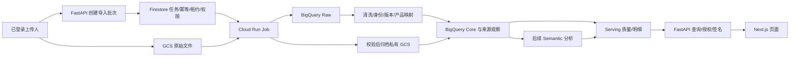

# 产品评论与差评分析系统方案

> 版本：V1.2；修订日期：2026-09-05。配套字段契约：统一评论字段字典内容版 v1.1。
> 云项目：feimei-product-voc；BigQuery/GCS：US；Cloud Run：us-central1（沿用已确认位置）。
> 技术路线：GCS + BigQuery + Cloud Run + Firestore 控制库 + FastAPI + Next.js/React；AI 分阶段接入。
> 本次交付为方案和字段字典修订；“设计已解决”不等于功能已实现或生产验收通过。

### V1.2 本次更新重点

- 统一命名、必填性、日期精度、商品粒度和版本规则；字段完整定义只在配套字典维护。
- 将来源作用域、商品映射作用域、评论身份作用域分别定义，修正跨店铺串数据和公开评论重复计数问题。
- 以可恢复的异步导入、控制库租约、BigQuery 批量发布和私有媒体归档作为阶段一实现基线。
- 明确首批验收一条来源链路，Amazon/TikTok/Mercado Libre 为优先扩展候选，AI/预警/闭环后置。
- 修正评论与销售分母解释，取消“永久保存”承诺；业务输入、执行者和验收证据见第 38 章。

## 0. 哪些问题现在可以解决，哪些需要人工

| 问题 | 本次已完成的技术方案 | 仍需人工提供／确认 | 是否阻塞工程开发 |
|---|---|---|---|
| 字段命名、可空性、枚举、分层 | 已统一到字典 v1.1，旧名只在适配器映射 | 无须逐字段人工选择 | 否 |
| 去重、编辑版本、旧文件重放、删除 | 已给出原生 ID/降级身份、观察表、版本顺序和删除证据规则 | 样本中原生 ID/源时间是否存在 | 不阻塞通用模块；阻塞平台验收 |
| 产品映射与跨店隔离 | 已给出别名表、作用域、有效期和冲突处理 | 缺失 SPU/SKU 与真实商品关系 | 不阻塞导入；缺失部分保持 pending |
| 文件与媒体处理 | 已定义异步任务、安全校验、重试、Hash、对象版本和 Signed URL | 真实媒体 URL、来源使用范围和隐私复核 | 可开发；真实归档按允许范围验收 |
| MVP 范围 | 已统一为一条完整导入链路后扩平台 | 首份实际来源及一名业务验收者 | 模拟数据开发不受阻 |
| 保留、删除、US 存放 | 已设计策略登记、到期处理、删除清单和重放防恢复 | 业务/数据负责人确认可处理范围及各类数据保留期 | 不阻塞开发；生产数据启用需明确 |
| 指标、销售分母 | 已定义评论指标及可选销售归一化指标，未知不补 0 | 实际订单口径、来源覆盖、匹配证据 | 不阻塞阶段一，未满足时隐藏销售指标 |
| 登录、人员、运行权限 | 已确定 Google 身份校验、服务端授权和 IAM 补齐方法 | 真实人员/范围、域名、部署配置 | 规则可实现；上线前核验 |

技术默认值由本方案确定，Codex/IT 可据此实现；真实样本、主数据关系和业务授权不能由技术设计虚构。第 38 章列出最小人工交付，不要求运营手工改造每次导出的 Excel。

---

## 1. 项目背景

目前各电商平台的产品评论数据分散，平台字段、产品标识、语言、星级规则和图片格式均不统一，产品团队很难快速回答以下问题：

- 某个产品最近的差评是否在增加？
- 差评增加是产品质量恶化，还是因为销量增长带来的评论量增加？
- 主要问题是产品功效、使用体验、包装、物流还是页面预期？
- 问题集中在哪些国家、平台、SKU、色号、规格或批次？
- 同一问题能否下钻到具体用户原声和评论图片？
- 是否出现了分类体系之外的新问题？
- 产品改善后，相关问题是否真正下降？

因此，需要搭建一个覆盖“数据采集—字段清洗—产品映射—语义分析—问题聚合—原声下钻—风险预警—问题闭环”的全渠道产品评论系统。

---

## 2. 系统定位

本系统不应仅被定义为“差评数据库”，而应定位为：

> **全渠道产品评论情报与产品问题闭环系统**

系统重点分析差评，但数据层建议尽可能收集 1～5 星全部评论。

### 2.1 为什么不能只收集差评

只收集差评会导致以下问题：

1. 无法准确计算差评率和平均星级趋势；
2. 无法判断差评数量增长是否仅由销量增长造成；
3. 无法发现高星评论中隐藏的负面反馈；
4. 无法分析用户认可的产品卖点；
5. 无法评估产品改版前后的整体评价结构变化。

例如：

> “颜色非常好看，但是使用两天后泵头开始漏液。”

即使这是一条 5 星评论，也应该识别出“包装—泵头漏液”问题。

因此，系统需要把以下两个维度分开：

- **评论星级**：用户给出的整体评分；
- **语义情绪与问题标签**：用户在不同评论片段中表达的具体正面或负面体验。

### 2.2 销售规模作为补充背景

评论是选择性、滞后的反馈样本。评论量除以同一日历窗口订单数，无法直接解释为购买用户的问题发生概率。

阶段一只展示导入覆盖范围内的评论量、有效星级结构、空文本和映射/归档质量。阶段二展示同一有效分析口径的去重问题评论指标。具备销售来源与范围对齐后，才可增加“每千单问题提及强度”“每千件问题提及强度”，并同时展示覆盖及时间差说明。

只有评论与原始购买订单、购买队列、观察成熟期可靠关联时，才能计算“购买队列中的问题反馈比例”；它仍不是所有真实问题的发生率。具体公式和启用条件见第 23 章。

---

## 3. 项目目标

### 3.1 数据目标

- 统一接收不同平台人工导出的 CSV、XLSX 文件；
- 建立平台字段映射和模板版本管理；
- 保留平台原始评论、原始星级、原始语言和原始图片；
- 将平台产品 ID 映射为公司内部品牌、SPU、SKU 和产品中文简称；
- 支持评论去重、评论修改版本识别和重复导入控制；
- 将结构化评论数据存入 BigQuery；
- 将评论图片和视频存入 Google Cloud Storage。

### 3.2 分析目标

- 分析产品的评论量、星级、低星率和问题趋势；
- 通过 AI 将杂乱评论拆分成多个语义片段；
- 将评论聚合到产品问题分类树；
- 支持一条评论对应多个问题标签；
- 支持不同国家、平台、品牌、产品、SKU、色号和时间范围汇总；
- 自动识别分类体系之外的新问题；
- 为每个 AI 判断保留用户原文证据和置信度；
- 支持评论图片的缺陷识别和图片证据展示。

### 3.3 业务目标

- 默认从产品维度查看问题；
- 从汇总指标下钻到具体用户原声；
- 对高风险或快速增长的问题发出钉钉预警；
- 将已确认问题分配给产品、包装、供应链、运营或客服负责人；
- 跟踪问题根因、改善措施、改善批次和改善后效果；
- 最终形成产品问题发现与整改闭环。

---

## 4. 系统范围与阶段边界

### 4.1 阶段一：一条可验收的人工导入链路

工程框架面向多平台，首批端到端验收限定一个来源模板、一个品牌、一个市场。先接入运营最先提供且可持续获取原文的真实来源，不以尚未验证的平台导出能力确定开工承诺。

Amazon、TikTok Shop、Mercado Libre 是第一批适配候选；它们按样本可用顺序依次验收，不要求三个同时上线。Noon、Shopify/独立站及其他平台属于后续扩展。来源模板应包含平台、真实评论系统、导出工具、市场和店铺/公开目录作用域。

### 4.2 阶段一功能

原文件上传、Raw 保留、字段转换、产品映射/异常队列、评论去重/版本/来源追溯、图片归档/异常队列、基础明细与质量报告。仅星级或仅标题记录可保留；缺 SPU/SKU 保留待映射。

视频先保留来源和元数据，默认 unsupported，不自动下载/转码；有明确业务需求及资源预算后单独启用。Embedding、LLM 分类、正式 AI 分析看板、钉钉预警和整改案件均不属于阶段一验收。

### 4.3 后续扩展

分阶段加入固定问题分类与人工审核、语义搜索与新问题发现、预警与问题闭环、来源自动化。客服、退货退款、社媒、达人评论、质检、供应商、批次、物流和问卷继续保留为扩展来源，不提前假设字段或访问权限已取得。

### 4.4 经营平台边界

本系统只读取授权来源。对 Amazon、TikTok Shop、Shopify、Mercado Libre、Noon 等经营平台不执行写回、回复、商品/广告/订单配置修改。后续钉钉通知只发送到明确授权对象，具备幂等、限流和审计；不自动创建机器人、群、Webhook 或改写平台状态。

---

## 5. 总体架构与事务边界



Landing 是 GCS 原始文件区，不另设 BigQuery Landing Dataset。Raw 保留可重解析源行，Core 承载内容版本和产品映射，Semantic 承载版本化 AI 结果，Serving 提供授权查询投影。

控制库选择 Firestore Native / us-central1，保存批次状态、幂等键、任务租约、访问规则、映射审核、删除请求和后续人工审核/案件。它是计划新增组件，尚未创建；review_control 继续作为批量审计和汇总投影。控制库变更与 BigQuery 提交采用 publication_id/outbox 对账，不宣称跨服务原子事务。

BigQuery 使用批量载入和发布，不承担上传进度、锁或每次审核点击的同步单行事务。[BigQuery 写入建议](https://docs.cloud.google.com/bigquery/docs/best-practices-performance-compute)

单次 HTTP 请求只负责身份校验、创建/确认上传和触发持久任务，返回批次 ID。数据处理在 Cloud Run Job 内执行；禁止返回 HTTP 响应后靠内存后台协程继续导入。

---

## 6. 图片、源文件与媒体归档

### 6.1 存储位置与版本

- 原始文件：gs://feimei-product-voc-raw/imports/{import_batch_id}/source.{ext}。
- 原始媒体：gs://feimei-product-voc-media/originals/{platform}/{country_code}/{review_id}/{review_version_id}/{media_index}-{sha256_hash}.{extension}。
- 安全展示副本：同一 media Bucket 的 display/ 前缀，使用对应身份/版本/Hash 路径。
- 导出文件：gs://feimei-product-voc-export/{export_job_id}/result.{ext}。

BigQuery 保存源 URL、gs:// 路径、GCS generation、Hash、状态和证据；不保存图片 BYTES 或长期 Signed URL。对象写入带 ifGenerationMatch=0，重复对象先核对 Hash 再复用，禁止覆盖旧版本。运营文件名、用户昵称和产品名均不充当对象键。

### 6.2 媒体下载技术规则

| 项目 | 工程默认值和处理 |
|---|---|
| 来源 URL | 只允许 HTTPS/443、来自已验证模板的精确域名白名单；URL 中 userinfo、IP 字面量拒绝；白名单为空时不下载 |
| DNS/网络 | 每次连接校验 A/AAAA 解析结果，拒绝私网、回环、链路本地、保留地址和 metadata 端点；连接固定已验证 IP 并保留 TLS 主机校验，防 DNS rebinding；同时用出口策略隔离内部服务 |
| 重定向 | 默认禁止自动跟随；确有 CDN 跳转时最多 3 跳，每跳重新执行域名/IP/协议校验，禁止携带跨站 Cookie/Authorization |
| 并发与超时 | 每域名并发 2；connect 5 秒、read 15 秒、整体 45 秒；均可配置 |
| 图片资源上限 | 原图 10 MiB、解码后 25 MP；按实际流读取限额，不能只相信 Content-Length |
| 文件验证 | MIME header、魔数、受限解码与尺寸联合检查；首期 JPEG/PNG/WebP；HTML/SVG/可执行文件拒绝，其他标记 unsupported；隔离扫描无异常后才允许展示 |
| 隐私处理 | 展示副本去 EXIF，含人脸/地址/电话/面单线索进入复核或遮挡；未过隐私复核只对指定审核者可见；不保证自动识别零漏报 |
| 重试 | 最多 3 次总尝试；网络超时/429/5xx 按 Retry-After 或退避抖动重试；403 不绕过访问限制；404 记 unavailable，不凭此认定原评论删除 |
| 日志 | 只写 error_code、host、media_id、大小和耗时；不写完整签名 URL、Cookie、令牌或用户内容 |

上述策略由 downloader 实施并用恶意 URL/重定向/超大文件样例验收。域名白名单根据真实导出样本填写，不凭经验放行整个平台所有域名。[OWASP SSRF 防护](https://cheatsheetseries.owasp.org/cheatsheets/Server_Side_Request_Forgery_Prevention_Cheat_Sheet.html)

### 6.3 下载、展示和失败恢复

下载状态统一 pending/downloading/success/failed/expired/unsupported；expired 仅在来源明确表明 URL 已到期时使用。媒体尚未完成不会丢弃评论；批次分别展示导入完成率与媒体归档完成率。

媒体任务租约、累计尝试次数和 next_retry_at 由控制库管理。进程崩溃后过期租约可重领，GCS Hash/generation 检查防止重复覆盖；BigQuery media 状态批量投影。没有必要首期增加复杂 Pub/Sub 流水线，先用同一 Job 的独立阶段/检查点恢复。

### 6.4 Signed URL 与访问权限

后端接受 media_id，不接受客户端任意 gcs_uri。按登录主体、来源/品牌/市场、当前删除状态及媒体复核状态验权后，对安全展示副本生成 5 分钟 GET V4 Signed URL。签名通过 IAM Credentials signBlob，不分发 JSON 私钥。访问令牌、签名 URL 不写入 BQ、日志或持久缓存。

签名者需要对象读权限，调用者还需签名者服务账号上的 iam.serviceAccounts.signBlob；项目级宽泛 Token Creator 不是必要前提。当前 API 的对象查看权限不能替代签名权限，补齐安排见第 27 章。[Cloud Storage 签名权限](https://docs.cloud.google.com/storage/docs/access-control/signing-urls-with-helpers)

Signed URL 在到期前可被持有者转用；撤权后停止新签名但已发 URL 不会自动立即失效。对要求每次访问立即鉴权的敏感原件，使用后端授权代理读取。图片页面设置 no-referrer，签名响应不进入共享缓存。

### 6.5 保留和删除

“不可覆盖”表示业务处理不修改原始证据，不代表无期限保留。Raw/媒体/Core 按已批准 retention_policy_id 保存；导出建议 7 天、临时文件 24 小时、无内容技术日志 30 天，均为待部署工程默认值。原始评论/媒体的业务保留期由第 38 章 H03 确认，未定前不执行自动删除，也不承诺无限期保留。

删除流程包括源文件和所有对象代数、BQ 历史版本、媒体副本、分析/向量、导出和缓存。备份、软删除及 time travel 可能有额外保留窗口，单独登记恢复可见性和物理清除时间；删除名单用于恢复/重导入后再清除，最小匹配标识本身也按批准政策保存。

---

## 7. 核心数据模型原则

Source/Standard/Enrichment 分层；原始文件与原文保留，清洗/翻译不覆盖；内容版本、产品映射版本和分析运行版本独立。一个评论可有多个来源观察、内容版本、媒体和问题片段。

商品主键按平台原生作用域确认，名称仅辅助；公开目录评论和店铺评论采用不同身份命名空间。上传上下文不能覆盖可信平台事实和已批准商品映射。SPU/SKU 缺失或只有父级粒度时明确标记，不强行补齐。

所有指标从当前已发布内容版本和指定映射/分析版本计算；历史内容、待映射、待裁决、未分析和媒体失败都有明确状态，不按 0 或无问题处理。受审计的合法删除优先于历史保留。

技术唯一性由 importer、控制库租约和发布检查保证；BigQuery 主外键声明本身不强制执行。[BigQuery 约束说明](https://docs.cloud.google.com/bigquery/docs/primary-foreign-keys)

---

## 8. 表设计与唯一字段来源

配套《统一评论字段字典 v1.0.md》的内容已升级为 v1.1；文件名暂保留。该文件唯一维护字段名、类型、可空性、枚举、主键、分区和兼容映射。本方案不再重复一套完整字段表。

### 8.1 阶段一实体

| 层 | 表／视图 | 作用 |
|---|---|---|
| review_control | review_import_batch | 导入批次与质量汇总，控制库状态的仓库投影 |
| review_raw | raw_review_source | 每个源 Sheet/数据行，保留原始列值和解析状态 |
| review_core | fact_review | 每条评论的确认内容版本 |
| review_core | dim_product_mapping | 有作用域和有效期的平台商品别名映射 |
| review_core | fact_review_media | 关联具体 review_version_id 的媒体引用与归档状态 |
| review_core | review_source_observation | 多次文件导入、店铺/来源观察到同一评论的血缘 |
| review_control | review_import_error | 批次/行级异常、解决事件 |
| review_control | import_publication_gate、import_publication | 全局发布门与内容提交清单 |
| review_serving | v_review_current、v_review_media | 当前内容、映射、媒体的授权查询投影 |

五张业务核心表之外，observation、error、import_publication_gate 和 import_publication 是追溯、恢复、串行发布辅助表；后者位于 review_control，字段详见字典。

### 8.2 后续分析和闭环

阶段二的文本分析运行和结果固定关联 review_version_id + analysis_run_id；媒体分析用 media_id + analysis_run_id（经 media_id 找到评论版本）；dim_issue_taxonomy 按 issue_id + taxonomy_version 版本化；向量另存 review_embedding，并以模型/维度分索引。用户原文证据偏移使用未修改原文的 Unicode code point [start,end)。

人工标签和案件通过控制库事务维护并追加审计，投影到 review_control；不覆盖模型原结果。案件保留原方案的负责人、根因、措施、改善批次、观察期和关闭证据，并关联公司现有任务 ID。

### 8.3 初始问题分类候选

保留产品功效、使用体验、色彩与规格、安全与刺激、质量稳定性、包装问题、页面与预期、物流履约、售后服务、价格与价值、真实性问题。每类包含定义、包含/排除例子、责任域和版本；候选词树由产品团队用真实评论复核后发布，不能将“疑似假货/过敏”等模型标签作为已证实结论。

| 一级分类 | 二级分类示例 |
|---|---|
| 产品功效 | 无效果、效果弱、持久度差、遮瑕不足、控油不足 |
| 使用体验 | 黏腻、拔干、搓泥、难清洗、气味不适、肤感厚重 |
| 色彩与规格 | 色差、显色不足、色号不合适、容量过小、规格不符 |
| 安全与刺激 | 过敏、刺痛、红肿、灼热、爆痘、眼部刺激 |
| 质量稳定性 | 分层、结块、变质、异味、干裂、融化、掉粉 |
| 包装问题 | 漏液、泵头故障、破损、封口异常、缺件、盖子松动 |
| 页面与预期 | 图文不符、功效误解、尺寸误解、使用方法不清 |
| 物流履约 | 延迟、运输破损、错发、少发、丢件 |
| 售后服务 | 退款困难、回复慢、解决方案不满意 |
| 价格与价值 | 太贵、容量不值、促销价差、性价比低 |
| 真实性问题 | 疑似假货、包装版本异常、批次差异 |

### 8.4 商品归属与主数据复用

复用现有平台商品键和人工维护来源，Codex 负责提取候选、规则映射和冲突清单；只有缺失/矛盾的真实商品关系交由负责人补充。已有 Amazon ASIN 中文简称/类目不能被自动当作完整 SPU/SKU。

映射遵循 variant → 店铺 SKU → Amazon ASIN → 产品级别名；所有可用键若互相冲突就进入审核，不按优先级掩盖冲突。明确到产品级的评论可汇总到 SPU；SKU 级报表必须有变体/订单等证据。

---

## 9. 字段清洗与有效性

处理顺序：原文件归档 → 文件/表头验证 → Raw 批量入库 → 字段转换 → 时间/评分/身份检查 → 来源观察和内容版本 → 产品映射 → Core 发布 → 媒体阶段 → Serving 质量更新。阶段一不触发翻译/AI。

canonical 字段固定为 country_code、brand_key、internal_spu/internal_sku、review_created_at_local（DATETIME）、review_created_at_utc（TIMESTAMP）、review_date_local（DATE）、rating_normalized_5、raw_payload、sha256_hash。旧名只在适配器兼容。

正文可空；有合法日期、星级和商品别名的记录可以导入。内部产品信息允许待映射；既不知道商品 ID 又无有效 ASIN/SKU 等别名的行保留 Raw 并隔离。未经证据确认，不从商品名称反推 ID。

源只有日期时保留 DATE、date_precision=date，两个时间戳为 NULL。需要转换而缺时区/夏令时歧义时进入异常，不猜。默认按已验证 1～5 星原样解析，其他量表依适配器明确转换。

用户原文按源值保留；清洗另存、翻译后置。文本为 =、+、-、@ 开头时不修改原文，CSV/Excel 导出时采取公式注入防护。用户标识和订单信息默认不进入普通 Serving，Raw 权限不能因需要看评论而整体开放。

---

## 10. 幂等、评论版本与删除

### 10.1 三种键分别管理

- 文件导入键：文件 SHA256 + source_scope_id + 模板/解析器版本 + 操作模式；同一逻辑请求重试返回原批次。
- 产品映射键：按平台和别名规定包含 marketplace/store/product/variant；Seller SKU 不能跨店复用。
- 评论身份键：按原生评论系统唯一范围定义 identity_namespace + source_review_id；公开目录评论不因多店导出而生成多条。

精确 canonical JSON/hash、fallback 身份、字段和例子见字典第 9 节。无原生 ID 时跨文件仅做指纹候选；匿名同文同星同日不保证是同一人，歧义不自动合并，质量报告显示 identity_confidence。

### 10.2 编辑、重放与新旧顺序

相同 ID 且内容与当前版本相同只新增 observation；匹配历史内容仍先核对源时间，以区分真实回改和旧文件重放。原文、星级或稳定媒体内容改变且有可信源时间，新增内容版本。源票数、商家回复、临时 URL、映射和分析状态变化不自动触发新内容版本。

旧快照重放不能把 current 回滚。不同内容没有可靠时序时，进入 version_order_status=pending_review，待人工裁决后发布；不能拿 uploaded_at 当用户编辑时间。

当前版本通过已确认版本顺序生成 v_review_current。fact_review 不维护冗余的 is_current_version；内容版本 ID 与分析运行 ID、映射发布 ID 分离，避免重跑模型增加评论数。

### 10.3 删除与状态

后续文件没出现某评论只说明没观察到，尤其 filtered_sample/incremental 不能证明删除。deleted/hidden 需要源显式状态或人工验证证据。源端删除状态与公司内部 erasure 请求分开；合法删除执行全链清除并记录非内容审计，历史回放需遵守删除清单。

---

## 11. AI 语义分析逻辑

阶段二启用；所有输出绑定 review_version_id + analysis_run_id，并记录 input_hash。翻译不是必须先于分类：能直接处理原文时以原文分析，中文翻译供理解。置信度阈值仅作路由，需独立样本校准，不能视为正确率。

### 11.1 总体处理链路

```text
评论原文
  ↓
语言识别
  ↓
可选翻译（原文仍是证据）
  ↓
评论拆句/观点拆分
  ↓
Aspect 与 Opinion 提取
  ↓
片段级情绪判断
  ↓
固定问题分类树匹配
  ↓
严重程度与责任域判断
  ↓
原文证据提取
  ↓
置信度评估
  ↓
低置信度/安全问题进入人工复核
  ↓
阶段三再启用 Embedding 与未知问题聚类
```

---

### 11.2 评论拆句

不能让模型对整条评论只输出一个分类。

例如：

```text
“颜色很好看，但是很拔干，而且泵头漏液。”
```

应拆成三个片段：

1. 颜色很好看；
2. 很拔干；
3. 泵头漏液。

然后分别判断：

- Aspect；
- Opinion；
- 情绪；
- 问题分类；
- 严重程度；
- 责任域；
- 用户原文证据。

---

### 11.3 固定问题分类

对于已知问题，使用多标签分类。

以下 JSON 是模型输出示意，解析器按字典转换并校验；示例分类 ID/分数不是已发布的业务定义：

```json
{
  "review_id": "rv_001",
  "review_version_id": "rvv_example_001",
  "analysis_run_id": "ar_example_001",
  "segments": [
    {
      "segment_text": "it dries out my lips",
      "evidence_quote": "it dries out my lips",
      "aspect": "lip feel",
      "opinion": "dries out",
      "issue_l1": "使用体验",
      "issue_l2": "拔干",
      "issue_l3": null,
      "sentiment": "negative",
      "severity": 2,
      "responsible_domain": "product",
      "is_safety_related": false,
      "confidence": 0.93
    }
  ]
}
```

### 11.4 AI 正式入库规则

AI 结果只有满足以下条件，才写入正式问题明细表：

- 输出结构符合 JSON Schema；
- 问题分类存在于当前分类树；
- 必须包含原文证据；
- 原文证据必须能在原评论中找到；
- 满足本次 analysis 发布规则；未校准的 confidence 不能单独决定正式发布；
- 不存在明显字段冲突。

不符合条件的结果进入待复核队列。

---

## 12. 已知问题与未知问题的混合识别

只依赖固定分类树会漏掉新问题，只依赖聚类又会导致报表分类不稳定，因此建议采用双轨制。

### 12.1 固定分类负责稳定报表

例如：

- 包装—漏液；
- 质量稳定性—结块；
- 使用体验—拔干；
- 安全与刺激—刺痛。

### 12.2 语义聚类负责发现新问题

例如大量评论出现：

- “旋转后膏体缩不回去”；
- “按压后无法回弹”；
- “盖子打开时会刮到膏体”。

这些评论可能都属于包装问题，但系统应进一步发现一个新的结构缺陷子类。

### 12.3 推荐处理链路

```text
新评论片段
  ↓
生成 Embedding
  ↓
与已知问题代表样本做相似度匹配
  ├─ 相似度高：进入已知问题分类
  └─ 相似度低：进入未知问题池
                    ↓
             BERTopic/HDBSCAN 聚类
                    ↓
             AI 生成候选问题名称
                    ↓
             人工审核和命名
                    ↓
             决定是否加入分类树新版本
```

### 12.4 向量存储建议

本章属于阶段三；不能把向量相似度当分类置信度。

第一阶段可直接使用 BigQuery 的向量能力保存 Embedding 和进行相似度检索，不必立即部署独立向量数据库。

只有在以下情况下，再考虑引入独立向量数据库：

- 评论规模和搜索并发量非常高；
- 需要低延迟实时语义搜索；
- BigQuery 查询延迟无法满足前端体验；
- 需要复杂 RAG 或跨数据源知识检索。

---

## 13. 人工复核与事务存储

阶段一复核产品冲突、身份歧义、版本顺序、敏感媒体和导入异常；阶段二增加低置信度、多标签冲突、未知问题、安全线索和高影响问题。没有原文证据的 AI 结果只能进入待复核区。

AI 输出不可变；人工修改另记 human_review_event，保存原分类、人工分类、理由、操作者、时间、review_version_id/analysis_run_id 和 expected_revision。控制库事务比较版本，冲突时返回 409 并要求重新读取，不能覆盖另一人的判断。审核完成后通过 outbox 批量投影 BigQuery，再更新可用分析发布版本。

模型 confidence 是未经校准的分数，不当成正确概率。使用按平台/语言/问题类分层、与调参集分开的验收样本，报告 precision、recall、覆盖和人工复核量；门槛由业务负责人结合误报/漏报代价确认。安全线索进入人工快速队列，但不是医学诊断或已确认产品事故。

产品映射和数据问题由业务事实确认；Codex 负责发现候选、给证据和生成待补清单，不要求业务人员维护英文技术字段。

---

## 14. 图片分析逻辑

属于后续 AI 阶段；仅处理已批准范围且通过安全/隐私检查的媒体。分析存 review_media_analysis，与原始媒体表分离，记录 media_id 和 analysis_run_id。

### 14.1 图片分析用途

图片不仅用于展示，还可以辅助识别：

- 包装漏液；
- 瓶体破损；
- 泵头故障；
- 产品结块；
- 膏体融化；
- 产品分层；
- 色差；
- 包装版本异常；
- 错发或少发；
- 运输挤压；
- 面单、地址等隐私信息。

### 14.2 图片分析输出

建议输出：

- 图片描述；
- 是否存在可见缺陷；
- 缺陷标签；
- 缺陷位置；
- 是否与评论文本一致；
- 分析置信度；
- 是否需要人工确认。

### 14.3 图片分析优先级

不需要第一阶段对所有图片都进行高成本分析，可以按以下优先级：

1. 1～2 星评论图片；
2. 安全风险评论图片；
3. 快速增长问题的相关图片；
4. 新问题聚类中的代表图片；
5. 人工主动发起分析的图片。

---

## 15. 产品问题摘要生成

摘要引用同一内容/分析发布版本，展示样本覆盖；销售归一化指标未启用时不要求生成该字段，不用语言模型补造分母。

不建议每次把数千条评论全文直接交给大模型总结。

推荐先用 BigQuery 生成结构化统计：

- 问题评论数；
- 已分析评论问题提及率；
- 环比变化；
- 国家分布；
- 平台分布；
- SKU 分布；
- 严重程度分布；
- 代表性评论；
- 评论图片数量；
- 新问题数量；
- 每千单问题提及强度。

再让大模型根据结构化数据生成摘要。

示例：

> 过去 30 天，A 产品的主要问题为泵头漏液，占包含负面问题评论的 31%，较前 30 天上升 12 个百分点。问题主要集中在美国 Amazon 和 TikTok Shop，涉及两个 SKU。代表评论显示，多数用户在使用 2～4 次后出现漏液。

摘要应明确标注：

- 数据时间范围；
- 评论样本数；
- 对比周期；
- 主要问题；
- 主要市场；
- 主要 SKU；
- 是否存在安全风险；
- 是否属于 AI 推断。

---

## 16. 前端看板信息架构

第 16～22 章保留完整产品蓝图，属于阶段二以后；阶段一只做第 32 章基础验证页面。所有指标使用第 23 章定义，销售归一化、AI 风险、聚类与通知在依赖满足前隐藏，不展示伪零值。

### 16.1 默认分析路径

系统默认入口应以产品为中心：

```text
品牌
  ↓
产品/SPU
  ↓
SKU/色号/规格
  ↓
产品问题
  ↓
国家/平台
  ↓
用户原声与图片
```

国家和平台是重要筛选维度，但不应作为默认首页入口。

---

## 17. 页面一：产品评论总览

### 17.1 页面目标

回答：

> 这个产品当前评论表现怎么样？主要问题是什么？问题是否正在恶化？

### 17.2 全局筛选器

- 日期范围；
- 品牌；
- 产品/SPU；
- SKU；
- 国家；
- 平台；
- 星级；
- 评论语言；
- 是否带图；
- 是否验证购买；
- 问题一级分类；
- 问题二级分类。

### 17.3 核心指标

- 全部评论数；
- 已导入样本平均星级；
- 1～2 星评论率；
- 3 星评论率；
- 4～5 星评论率；
- 包含负面问题的评论率；
- 每千单问题提及强度；
- 高严重度问题数；
- 新出现问题数；
- 安全风险评论数；
- AI 分析覆盖率；
- 产品映射覆盖率。

### 17.4 趋势图

建议支持切换：

- 评论量；
- 已导入样本平均星级；
- 已导入样本低星率；
- 已分析评论问题提及率；
- 每千单问题提及强度；
- 高严重度问题数；
- 新问题数量。

### 17.5 Top 问题 Pareto

以下数字仅为布局示例，不是实际经营结果；销售强度未通过第 23 章条件时该列不显示。

| 问题 | 去重评论数 | 已分析评论问题提及率 | 环比 | 每千单提及强度 | 严重度 | 趋势 |
|---|---:|---:|---:|---:|---|---|
| 泵头漏液 | 86 | 12.1% | +34% | 4.8 | 高 | 上升 |
| 拔干 | 62 | 8.7% | -5% | 3.5 | 中 | 下降 |
| 色差 | 41 | 5.8% | +8% | 2.3 | 中 | 稳定 |

点击任意问题可进入问题分析器。

---

## 18. 页面二：问题分析器

### 18.1 页面目标

回答：

> 某个问题主要发生在哪些产品、国家、平台、SKU、色号、规格和时间段？

### 18.2 页面组件

- L1/L2/L3 问题分类树；
- 问题趋势图；
- 国家 × 平台热力图；
- 产品 × 问题热力图；
- SKU/色号 × 问题热力图；
- 星级分布；
- 严重程度分布；
- Verified Purchase 占比；
- 带图评论占比；
- 代表性用户原声；
- 相关评论图片墙；
- 相似问题聚类；
- 新问题候选；
- AI 摘要；
- 关联问题整改任务。

### 18.3 下钻逻辑

点击任意图表元素，打开评论明细抽屉，并自动继承筛选条件。

例如：

```text
点击“美国 × TikTok Shop × 泵头漏液”
  ↓
打开对应评论明细
  ↓
显示用户原文、翻译、星级、时间、SKU、图片和 AI 标签
```

---

## 19. 页面三：用户原声库

### 19.1 评论卡片字段

- 品牌；
- 产品中文简称；
- SPU/SKU；
- 色号/规格；
- 国家；
- 平台；
- 评论时间；
- 评论星级；
- 原始语言；
- 原始评论；
- 中文翻译；
- 评论图片或视频；
- 问题标签；
- 语义片段；
- 严重程度；
- AI 置信度；
- Verified Purchase；
- 平台评论链接；
- 是否人工复核；
- 商家回复。

### 19.2 主要功能

- 关键词搜索；
- 语义搜索；
- 按评论原文搜索；
- 按问题标签筛选；
- 图片放大；
- 查看相似评论；
- 修改 AI 标签；
- 标记 AI 误判；
- 加入问题案例；
- 导出评论；
- 复制用户原声；
- 查看同一产品的关联评论。

### 19.3 语义搜索示例

用户可输入：

> 找出所有提到使用几次后开始漏液的评论。

系统返回语义相似评论，而不仅是包含“漏液”关键词的评论。

---

## 20. 页面四：新问题与风险预警

阶段四启用；接收对象与范围须明确。发送采用事件 ID 去重、冷却、限流、有限重试和审计；失败不能扩大接收人，使用测试目标或 Dry Run 验证后再启用。

### 20.1 预警类型

| 预警类型 | 示例规则 |
|---|---|
| 安全风险 | 出现过敏、灼伤、污染、异物等高风险标签 |
| 问题突然上升 | 当前问题提及率明显高于历史基线 |
| 新问题聚类 | 低相似度评论形成稳定语义簇 |
| 跨市场扩散 | 原本单一国家问题开始出现在多个国家 |
| SKU 集中 | 问题集中在某个色号、规格或 SKU |
| 图片缺陷集中 | 多张图片识别出相同缺陷 |
| 数据断流 | 某平台长时间没有导入数据 |
| 映射异常 | 某次导入大量产品无法映射 |
| AI 质量异常 | 低置信度比例突然升高 |

### 20.2 钉钉预警内容

- 品牌；
- 产品中文简称；
- SKU；
- 国家；
- 平台；
- 问题名称；
- 当前问题评论数；
- 当前问题提及率；
- 历史基线；
- 增长幅度；
- 严重程度；
- 代表性评论；
- 代表性图片；
- 前端详情链接。

### 20.3 预警防噪规则

避免因为样本过小产生大量无效通知：

- 设定最低评论数；
- 销售分母已启用时才应用最低订单量；
- 同一问题设置冷却时间；
- 区分首次预警、持续预警和恢复通知；
- 高风险安全问题不受最低样本数限制；
- 允许用户按品牌或产品配置不同阈值。

---

## 21. 页面五：AI 审核中心

### 21.1 待审核队列

- 低置信度分类；
- 新问题候选；
- 安全风险问题；
- 图片和文字冲突；
- 无证据分类；
- SKU 映射异常；
- 翻译异常；
- 用户主动标记的 AI 误判。

### 21.2 审核动作

- 批准；
- 拒绝；
- 修改分类；
- 修改严重程度；
- 修改责任域；
- 合并到现有问题；
- 创建新问题分类；
- 加入评估数据集；
- 创建产品问题案件。

---

## 22. 页面六：产品问题闭环

阶段四启用；案件链接公司既有稳定任务 ID，完成/取消状态不另造冲突来源。前后指标使用固定 metric_definition_version，缺分母/样本时保持 NULL。

### 22.1 问题状态

```text
新发现
  ↓
已确认
  ↓
调查中
  ↓
整改中
  ↓
观察中
  ↓
已关闭
```

### 22.2 问题详情

- 问题名称；
- 影响产品；
- 影响 SKU；
- 影响国家和平台；
- 评论问题提及率；
- 订单暴露量；
- 代表性原声和图片；
- 根因；
- 责任团队；
- 负责人；
- 整改措施；
- 生效批次；
- 计划完成时间；
- 改善前后指标；
- 关闭结论。

### 22.3 关闭标准

问题不能因为“已经采取行动”就直接关闭，应至少检查：

- 改善后问题提及率是否下降；
- 低星率是否下降；
- 每千单提及强度是否下降；
- 相关退货原因是否下降；
- 相关客服投诉是否下降；
- 是否出现新的关联问题；
- 是否覆盖所有受影响 SKU 和批次。

---

## 23. 核心指标合同

所有评论计数使用已发布的当前逻辑 review_id，排除身份未裁决、质量隔离、源已明确 hidden/deleted 及已执行内部删除的记录；同一评论的多个片段/版本/媒体不增加分母。筛选、数据发布日期、映射发布版本和分析发布版本必须一致。

| 指标 | 固定公式与显示条件 |
|---|---|
| 已导入有效评论数 | 当前去重且有效的评论数，明确 source coverage；不声称等于平台全量 |
| 已导入样本低星率 | 当前 1～2 星评论数 / 全部有效星级评论数；3 星单列。覆盖未验证或只导差评时标记样本，不能呈现为平台低星率 |
| 已分析评论问题提及率 | 提及该问题的去重评论数 / 同一分析发布版本成功完成分析的可分析评论数；未分析不当无问题 |
| 问题占负面评论比 | 提及该负面问题的评论数 / 至少包含一个有效负面标签的评论数；多标签各类之和可超过 100% |
| AI 分析覆盖率 | 成功分析的当前内容版本数 / 当前可分析评论数，空文本和待审核单独报告 |
| SPU 映射覆盖率 | 已确认 SPU 的当前评论数 / 当前有效评论数 |
| SKU 映射覆盖率 | 有变体证据且已确认 SKU 的当前评论数 / 当前有效评论数；另报来源支持 SKU 的评论占比 |
| 媒体归档率 | 成功归档引用数 / 已发现可支持的媒体引用数；unsupported、pending、failed 分别展示 |

### 23.1 销售分母指标：后续按条件启用

“每千单问题提及强度”=同一来源/品牌/市场/产品和本地日期窗口的问题去重评论数 / 对应有效订单数 × 1000；件数版本使用有效销售件数。它是按销售规模归一化的观察强度，评论和购买有时滞，不能叫真实问题发生率。

启用前必须有：独立销售来源的 source_reference、metric_definition_version、授权过滤、日期/时区、订单去重/取消规则、产品粒度、覆盖/新鲜度证据。沿用已确认的公司销量口径，不以平台另一种报表替换；评论文件的 purchase_quantity 或可见订单号不能推算全量销售。跨项目只获取批准的最小聚合/视图，不开放旧项目底层。

分母缺失、0、范围不一致或粒度不支持时返回 NULL + unavailable_reason，页面隐藏或显示“口径未就绪”，不补 0。同产品订单在多 SKU 上出现时，在产品层先去重订单；不能把子 SKU 订单数简单相加。

如果以后具备确定的订单关联和成熟购买队列，可以另报“购买队列问题反馈比例”：队列中至少一条问题评论的去重订单 / 同一成熟队列有效订单；必须展示观察成熟期、关联率和选择偏差，仍不等于所有真实故障率。

### 23.2 增长、风险和改善评估

增长比较使用不重叠窗口：最近 14 个完整本地日与此前 56 个本地日；窗口示例 D-13…D 与 D-69…D-14，D 为最近数据完整日。比较问题提及率和绝对增量，基线 0 时显示“新增”，不制造无穷大。

样本量、分析覆盖、分类版本/构成改变会影响趋势，覆盖不一致时停止自动风险排名。复合风险权重、告警阈值和安全响应时限由业务团队在阶段二/四确认，首期不发布任意乘积风险分数。

改善前后展示时间、产品版本、来源和样本结构变化；没有订单/批次证据时只能做观察比较，不声称证明改善造成下降。

---

## 24. 人工导入：具体执行流程

### 24.1 上传、预览与确认

1. 登录后选择已授权 source_scope_id、市场和店铺；品牌仅提示。服务器验证上传人的实际范围。
2. 创建 import_batch_id，生成一次性源文件对象路径。浏览器按受限签名上传；确认接口核验 generation、实测大小和字节 Hash，匹配成功才入队。
3. 读取原始 CSV/XLSX，禁止执行宏、公式或外部链接；XLSX 解压总量默认 100 MiB、文件 20 MiB、50,000 数据行，超限拆批。原始文件不覆盖。
4. Preview 使用固定模板/解析器版本；展示前 200 行和全批扫描的分类计数，不能把抽样预览当全量质量验收。表头重复保留列索引，未知模板隔离，不按模糊匹配静默猜列。
5. 用户确认导入时校验预览绑定的文件 Hash/generation、解析器/映射版本；任何变化须刷新预览。写入与媒体执行交给持久 Cloud Run Job。

### 24.2 写入、恢复与幂等

上传前以登录主体 + request_idempotency_key 对网络重试去重；上传确认后才计算文件 idempotency_key 并用控制库事务查重。相同文件键返回实际处理批次，临时上传批次记 deduplicated / duplicate_of_batch_id，不重复生成 Raw/Core。每次运行有 attempt_id；“同文件明确重解析”记录 replay_of_batch_id 和新 parser_version，正常重试不创建新批次。

按 5,000 行暂存批量装载 Raw/staging；装载分块不等于发布分批。首期最多 50,000 行的合格批次使用一次内容发布事务，发布清单字段见字典第 11 节。只在质量检查通过后将确认内容/observation/媒体引用和 publication_id 发布到 BigQuery；异常行留 Raw/error。BQ Job ID 确定化，超时不直接重复提交，先查询原 Job。

初版全流水线先只允许一个发布写者。Firestore 分配租约与递增 fencing token；新持有者先推进 review_control.import_publication_gate，随后每个 BQ 发布事务都必须校验 token 并更新同一 gate 行后再合并事实，冲突中止重读。仅在事务前检查 Firestore 不足以阻止竞态；完整 gate 字段和操作见字典第 11 节。仅设置 Cloud Run task parallelism=1 不等于全局串行。大批次断点含文件位置、staging 批号与已提交 Job ID。

媒体作为独立检查点运行，可单独恢复失败项，不重导已经发布的文字。最终分别回报 import_status 和 media_status；部分失败有清楚去向。

### 24.3 平台映射和原始数据保护

配置保存源真实表头、source_system/provider、市场/店铺作用域、日期格式/精度/时区、评分量表、商品别名、多图分隔符、URL 域名和 parser/template 版本。真实样本未取得前配置 adapter_status=unverified，列名清单为空；不能把示例当实测适配器。

运营不逐行补 SPU/SKU/产品名。自动复用公司主数据，只有缺失/冲突关系进入待处理表。上传提示品牌与映射品牌冲突时标记，不按提示覆盖。

文件不重复计数与评论不重复计数分别验收；多次导入仍完整保留来源观察。评论数不要求等于源文件行数，要求每行去向可解释。

---

## 25. 数据质量与异常处理

| 检查项 | 行为 |
|---|---|
| 模板未知、文件损坏、精度丢失 | 原文件保留，批次/行隔离并给错误码；不伪造成功 |
| 无合法评论日期、评分、任何商品别名 | Raw 正常保留；Core 隔离 |
| 只有日期、无时间戳 | 可接受；date_precision=date，UTC 为 NULL |
| 空标题/正文、未知购买验证 | 可接受；text_available=false，verified_purchase=NULL |
| SPU/SKU 未映射或只有父级 | Core 保留；pending 或确认到 SPU，不能强制 SKU |
| 产品别名冲突、错品牌/店铺 | 停止自动映射/发布产品归属，进入复核 |
| 匿名评论身份或内容时序歧义 | Raw/observation 保留，排除已去重指标直到裁决 |
| 图片失败/unsupported/隐私未通过 | 评论保留；媒体独立状态；不向普通用户展示 |
| 只有低星/来源覆盖未知 | 指标标记导入样本，不冒充平台全量 |
| AI 无证据或结构错误 | 阶段二保留失败/复核记录，不加入正式问题统计 |

解析完成后按源行核验：total_rows = new_rows + updated_rows + duplicate_rows + quarantined_rows。unmapped_rows、text_missing_rows、media_failed_count 是重叠质量维度，不加入行数守恒式。

每批报告文件 Hash、源范围、模板/解析器、行去向、逻辑评论数、SPU/SKU 各自覆盖、版本冲突、原文一致性、媒体发现/归档/失败/待处理和 publication_id。初版不设未经业务确认的映射率数字门槛：已确认部分可发布并显示覆盖；冲突不能进入有归属产品指标。

---

## 26. BigQuery 性能与成本设计

分区和聚簇按字典第 11 节逐表固定，每表不超过四个聚簇列；不能把七个高频维度全写进同一 CLUSTER BY。[BigQuery 聚簇文档](https://docs.cloud.google.com/bigquery/docs/clustered-tables)

API 只查询 review_serving 的受控视图/物化快照。Core 来源视图要登记相应 Authorized View，或者由 Worker 发布实际 Serving 表；不能为了查询方便给 API 开放 Raw。

工程默认：UI 查询窗口 90 天、明细分页 50（最大 200）、单查询 maximumBytesBilled=256 MiB、应用等待 30 秒，超时取消/记录 Job；不是云费用保证，按真实数据调整。导出使用独立异步任务、默认 100,000 行上限并验证权限。BQ 作业即使客户端超时仍须追踪原 Job，避免重复计费。

历史全量去重不能通过最近 90 天筛选代替。review_identity_registry 字段及提交后对账规则见字典第 11 节；索引缺失不能据此判定评论不存在。importer 基于 review_identity_registry 保存的 review_id→已知日期/版本指针读取必要历史分区；跨老分区更正使用受控后台任务并显式扫描预算。前端强制日期条件不套用于所有管理/恢复查询。

部署时 API min instances=0、max instances=2；Job 单任务并通过控制库限制同时执行数。Cloud Run、BigQuery 查询、GCS、Firestore、出口和后续 AI 分别计量。月预算金额及告警接收人由负责人给出，预算告警不是硬性停费开关；本次不自动创建费用规则。

---

## 27. 应用实现与当前云资源交接

### 27.1 技术选择

| 模块 | 固定设计 |
|---|---|
| Web | Next.js/React/TypeScript，正式图表按后续阶段接 ECharts |
| API | FastAPI；数据查询、状态、用户授权、媒体签名 |
| 任务 | Python importer/cleaner/media-downloader，Cloud Run Job，批量和可恢复检查点 |
| 原始数据/媒体/导出 | 既有三类私有 GCS Bucket |
| 分析仓库 | 既有五个 BigQuery Dataset，US |
| 控制面 | 计划新增 Firestore Native，us-central1 |
| 身份 | Google OIDC 服务端验证和会话；按固定 allowlist/source scope 授权，不仅判断邮箱域名 |
| 后续模型 | Vertex AI/Gemini 或已批准网关；选择前先做真实样本评测与预算，阶段一不调用 |

保持已有服务模块/目录可独立演进，首期部署为少量服务和一个 Job，不为每个 Python 模块新建微服务。Google OIDC 必须验证 issuer、audience、signature、expiry、sub 和 email_verified；会话 cookie 使用 HttpOnly/Secure/SameSite 并有 CSRF 防护。登录入口可到达不等于数据接口可匿名访问；后端数据请求必须鉴权。

### 27.2 已创建资源（2026-09-04 创建记录）

- Project feimei-product-voc / feimei product VOC，number 926086630480；绑定用户已指定结算账户。
- BigQuery US：review_raw、review_core、review_semantic、review_serving、review_control。
- GCS US：feimei-product-voc-raw、feimei-product-voc-media、feimei-product-voc-export，UBLA/PAP 已启用。
- Docker 仓库：us-central1-docker.pkg.dev/feimei-product-voc/review-dashboard。
- 运行账号：review-api-runtime@feimei-product-voc.iam.gserviceaccount.com、review-worker-runtime@feimei-product-voc.iam.gserviceaccount.com。
- IT：1257960851@qq.com 已获限定开发/数据权限。Firestore、应用服务、业务表、上传签名账号均属于后续实现项；API 已启用不代表应用已部署。

### 27.3 部署时补齐的权限与验证

2026-09-05 只读检查项目 IAM：Job User 绑定目前只有 IT；API/Worker 没有该项目级绑定。API 服务账号 IAM 当前只见 IT 的 Service Account User，未见签名授权。此前“数据集/Bucket 授权已完成”不能作为运行时查询/签名已验收的依据。

| 执行身份 | 部署需要 | 当前缺口／设计 |
|---|---|---|
| API runtime | BigQuery Job User + Serving Data Viewer | 保留只读 Serving；补项目作业权限，回读真实查询 |
| Worker runtime | BigQuery Job User + 指定数据集 Data Editor | 已有数据集权限；补作业权限，验证批量 load/MERGE |
| API runtime 作媒体签名者 | 对其自身 SA 的 signBlob + 所需媒体读取 | 用仅含 signBlob 的自定义角色绑定到具体签名 SA；无私钥、无项目级广泛代签 |
| 上传签名者（计划新增 review-upload-signer） | raw Bucket Object Creator | API 仅在此具体签名账号上拥有 signBlob；生成 server-assigned imports/ 对象的短期 PUT URL，确认时核验大小/Hash/generation；精确前端域名 CORS |
| API/Worker 控制库 | Firestore 服务端读写所需 IAM | 仅用于应用控制库；服务端 SDK 权限不能靠客户端 Security Rules 代替，多品牌验证仍在 API/Worker |
| API 触发导入 | 具体 Cloud Run Job 的执行权限 | 仅命名 Job；每次触发仍校验批次归属/幂等，不信任任意客户端环境变量 |
| 自动化构建身份 | 仓库写入、部署和指定 runtime 的 actAs | IT 的角色不会自动传给 Cloud Build 身份；选择专用 build SA 后逐项验证 |

新增 IAM 绑定、自定义角色、签名账号和启用 Firestore 由现有项目 Owner/具备相应管理权限者执行；IT 当前权限不含 IAM Admin，也不能把部署权限当作授权管理权限。IT 按本表提出精确资源/角色清单，管理员完成后再回读验证。运行时需要 Secret 时按单 Secret 授权，Secret Viewer 不等于读取内容。应用不用自动生成的 Compute 默认 Editor 账号；不要在未评估依赖时盲目撤销它。以上为可执行交接设计，本次仅修订文件，未修改 IAM。

### 27.4 恢复验收

模拟上传后进程退出、BQ 已提交但控制库未完成、媒体已上传但 metadata 未写入、同时重试两个 Job、解析器升级重放，均须恢复到唯一发布状态；记录 publication_id、Job ID、错误码和恢复操作。

---

## 28. 权限设计

GCP IT 权限与业务用户权限分开。业务登录主体用 Google sub；访问名单保存品牌、country_code、source_scope_id、能否查看原声/媒体/导出/修改标签。默认拒绝，没有配置的用户不能读取数据。

每次列表、统计、搜索、详情、媒体签名和导出都在服务端注入同一授权范围，忽略客户端自报品牌权限。查询使用参数化值和服务端白名单对象名。分页游标签名并绑定查询/权限版本；缓存键包含主体范围与 policy_version。

产品/运营/客服/供应链/分析员/只读角色保留，但“角色名称”本身不是授权范围。未映射评论按来源上下文授权，只在导入/映射队列显示，不能以 NULL brand 获得跨品牌公共访问。

普通用户不直接读取 Raw、订单 ID、用户主页或原图；受限详情、敏感图和导出记录审计。已撤权用户停止新查询、导出下载和媒体签名；已签 URL 的短有效期限制见第 6 章。人工审核/案件写入采用 expected_revision 防并发覆盖。

IT 负责部署和权限测试；用户/业务负责人提供实际访问名单。不要因为一名 IT 能看全项目就认为多人看板已经完成品牌隔离。

---

## 29. 开源与 GitHub 复用建议

公开项目大多只能覆盖单一评论分析或演示场景，不建议直接作为整个系统底座。更合理的方式是复用成熟组件，并按照内部数据模型重新组装。

### 29.1 BERTopic

项目地址：[MaartenGr/BERTopic](https://github.com/MaartenGr/BERTopic)

适合复用：

- 新问题发现；
- 评论语义聚类；
- 动态主题趋势；
- 层级主题；
- 代表评论提取；
- 相近问题合并。

建议定位：

> 用于未知问题发现，不直接替代业务问题分类树。

---

### 29.2 Sentence Transformers

项目地址：[UKPLab/sentence-transformers](https://github.com/UKPLab/sentence-transformers)

适合复用：

- 多语言评论向量；
- 相似评论检索；
- 评论近似去重；
- 相似问题匹配；
- 聚类；
- 语义搜索。

阶段三可评估 BigQuery 原生 Embedding；阶段一不生成向量。

---

### 29.3 PyABSA

项目地址：[yangheng95/PyABSA](https://github.com/yangheng95/PyABSA)

适合复用：

- Aspect Term Extraction；
- Aspect Polarity Classification；
- Aspect-Sentiment Triplet Extraction；
- 形成“对象—观点—情绪”结构。

上线前需要使用彩妆和护肤评论进行准确率评估，不能直接假设通用模型适合内部业务。

---

### 29.4 KeyBERT

项目地址：[MaartenGr/KeyBERT](https://github.com/MaartenGr/KeyBERT)

适合复用：

- 从聚类中提取关键词；
- 给新问题生成候选名称；
- 提取代表性短语；
- 看板关键词展示。

---

### 29.5 Label Studio

项目地址：[HumanSignal/label-studio](https://github.com/HumanSignal/label-studio)

适合复用：

- 评论片段标注；
- AI 预标注后的人工确认；
- 图片缺陷标注；
- 建立训练集和评估集；
- 低置信度评论审核。

可以先参考其标注交互，再在自建前端中实现轻量审核中心；不一定必须单独部署。

---

### 29.6 Great Expectations

项目地址：[great-expectations/great_expectations](https://github.com/great-expectations/great_expectations)

适合复用：

- 文件字段完整性检查；
- 必填字段验证；
- 日期和星级范围验证；
- SKU 映射覆盖率检查；
- 重复数据监控；
- 导入批次质量报告。

如果第一阶段数据量不大，也可以先用 Python + BigQuery SQL 自建规则，后续再引入。

---

## 30. 类似项目的参考方式

公开的评论分析项目通常可以参考：

- 页面布局；
- Top Pros/Cons 展示；
- 主题趋势；
- 情绪分布；
- 评论下钻；
- 语义搜索；
- AI 摘要。

但通常不具备以下生产能力：

- 多平台统一数据模型；
- 内部 SPU/SKU 映射；
- BigQuery 分层；
- 图片长期保存；
- 评论版本控制；
- AI 模型和 Prompt 版本管理；
- 问题分类版本管理；
- 企业数据权限；
- 订单量分母；
- 产品问题整改闭环。

因此建议：

> 参考开源项目的单点能力和交互，不直接 Fork 成正式系统。

---

## 31. 实施阶段与退出条件

| 阶段 | 交付 | 进入下一阶段的证据 |
|---|---|---|
| 0：样本与配置 | 一个真实来源模板、覆盖说明、字段 Mapping Spec、现有主数据候选；通用 Schema 可先按模拟数据开发 | 能重复取得原文，已确认 ID/时间/媒体格式和使用范围 |
| 1：导入底座 | 上传/预览、Raw/Core、产品映射、身份/版本/来源观察、私有图片、安全签名、质量/异常页面 | 第 35 章阶段一数据、恢复、权限验收通过 |
| 2：固定分类与审核 | 语义片段、多标签、证据、人工修正、问题分析器和正式产品总览 | 独立真实样本按类评测，业务验收者确认有用；安全线索有人处理 |
| 3：搜索与新问题 | Embedding、相似检索、聚类候选、分类树版本 | 新来源/新类具证据，不破坏历史指标合同 |
| 4：预警与闭环 | 有责任人/响应时限的风险通知，根因/措施/批次/观察/关闭 | 已授权通知目标、噪声与恢复测试、现有任务状态关联 |
| 5：扩平台和自动化 | 第二/第三来源及可取得授权的 API/售后/质检等 | 每种来源独立重复阶段 0 的数据验收，不默认字段同构 |

第一批优先平台仍为 Amazon、TikTok Shop、Mercado Libre，但不是阶段一同时上线承诺；初次验收来源由 H01 实际样本确定。单源验收通过可在阶段二前扩第二个模板，前提是同样通过来源与质量门禁。

---

## 32. 本次冻结的 MVP 范围

MVP 指第 31 章阶段一：一条真实模板链路、一个品牌/市场的首批验收，工程结构可配置扩展。交付上传与批次质量、原文查询、产品映射/版本、私有图片查看和异常恢复。

阶段一的基础验证页只验收导入、映射和证据查阅；第 17～22 章是后续完整产品蓝图，不整体计入首批工期。Semantic Dataset 已创建不代表 MVP 必须运行 AI。

工程现在可开始：按字典生成本地 Schema/DDL、模拟数据测试、实现通用导入/去重/媒体安全模块。样本到达后补实际 Mapping Config，再进行真实验收。无需人工先决定每个技术字段、每个重试参数或是否拆微服务。

人工最小输入：H01 真实样本与来源范围、H02 缺失产品关系、H03 数据使用/保留政策、H04 访问名单和验收人；其他 AI/销售/预警输入后置，见第 38 章。

---

## 33. 开发目录建议

```text
product-review-intelligence/
├── apps/
│   ├── web-dashboard/
│   └── admin-console/
├── services/
│   ├── api/
│   ├── importer/
│   ├── cleaner/
│   ├── media-downloader/
│   ├── semantic-analyzer/
│   ├── embedding-worker/
│   ├── clustering-worker/
│   └── alert-worker/
├── packages/
│   ├── shared-types/
│   ├── taxonomy/
│   ├── platform-adapters/
│   ├── data-quality/
│   └── ui-components/
├── sql/
│   ├── ddl/
│   ├── transformations/
│   ├── serving/
│   └── quality-checks/
├── prompts/
│   ├── review-segmentation/
│   ├── issue-classification/
│   ├── image-analysis/
│   └── summary-generation/
├── configs/
│   ├── platforms/
│   ├── alert-rules/
│   └── model-versions/
├── tests/
│   ├── unit/
│   ├── integration/
│   ├── data-quality/
│   └── model-evaluation/
└── docs/
    ├── PRD.md
    ├── DATA_DICTIONARY.md
    ├── TAXONOMY.md
    ├── API_SPEC.md
    └── OPERATIONS_SOP.md
```

---

## 34. 配置项与默认值

| 配置组 | 当前确定设计 | 值的来源 |
|---|---|---|
| 云位置 | BQ/GCS US，Run/Firestore us-central1 | 用户已确认位置；Firestore 为设计新增 |
| schema | v1.1，唯一命名、空值和键见字典 | 本次技术修订 |
| adapter | unverified；真实列名/源时区/ID 范围/多图规则等待样本 | H01；可先用明确标注的模拟数据 |
| identity | namespace + native ID，降级指纹显式标识 | 本方案第 10 章 |
| upload | 20 MiB、50,000 行、XLSX 解压 100 MiB、预览 200 行 | 工程默认，可配置 |
| ingestion | 5,000 行分块、租约单写者、确定性 BQ Job ID | 工程默认 |
| media | HTTPS/域名白名单、10 MiB/25 MP、每域并发 2、最多 3 次尝试 | 工程默认，域名取真实样本 |
| signing | V4 GET 5 分钟，signBlob 无私钥 | 工程默认 |
| querying | 90 天、50 行/页、最大 200、256 MiB/作业、等待 30 秒 | 工程默认；大任务单独受控 |
| retention | 原始/媒体/Core 由 policy_id 驱动；导出 7 天/临时 24 小时/无内容日志 30 天为建议 | H03 确定业务保留期；不自动启用删除 |
| AI / alerts | 阶段一关闭；模型/Prompt/词树/评测和权重独立版本 | 阶段二/四输入 |
| access | Google 主体验证、明确来源/品牌/市场/动作权限 | H04 |

把配置发布版本写入批次和分析结果。技术默认值不是性能承诺、法律期限或生产费用上限；真实验收后按同一版本机制调整。

---

## 35. 验收标准与证据

### 35.1 阶段一必须通过

| 场景 | 预期与证据 |
|---|---|
| 原始导入 | 文件 Hash/generation 可回查；解析行与 Raw 行对应；源重复表头和 ID 字符串不丢失 |
| 行数守恒 | 四类互斥去向之和等于非空数据行；警告不重复计入失败 |
| 重复上传 | 相同文件同上下文重复提交/网络重试返回同一批次，逻辑评论数不增长 |
| 跨来源观察 | 同一个公开原生评论跨店导出不重复计数；不同店铺局部 ID 不误合并；血缘完整 |
| 编辑与旧文件 | 新内容生成版本，旧快照重放不回滚；无时序证据进入裁决 |
| 空值与商品粒度 | 日期型记录、无正文、未映射 SPU/SKU 均按字典处理；产品级不伪造 SKU |
| 映射冲突 | 别名多目标、有效期重叠、跨店 SKU 均拦截；人工修正有发布版本 |
| 媒体 | 多图逐项保留，失败/unsupported 独立报告；原 URL 失效后已归档安全副本可用 |
| 下载攻击输入 | 私网、metadata、DNS 重绑定、恶意跳转、HTML 假图片、超大/解压炸弹均拒绝或隔离 |
| 恢复与并发 | 同时两个 Job、失效租约、BQ 成功后进程退出、GCS 成功后 metadata 失败均不会重复发布 |
| 授权 | 真实不同身份验证列表/详情/搜索/导出/图片；客户端篡改品牌/对象路径不能越权 |
| 删除演练 | 模拟批准删除后所有查询和新签名不可见，重导入/备份恢复不重新暴露；物理保留窗口有记录 |

不要求“所有评论映射到 SKU”才认为 importer 可运行；要求未映射和粒度缺失诚实显示、已映射关系可验证。字段/唯一性/链接检查可以本地完成，真实数据覆盖、人员权限与恢复验收必须在部署环境补证据。

### 35.2 后续阶段验收

AI 每条问题具原文证据，关联正确 review_version_id/analysis_run_id；模型/Prompt/词树变化不重复累计，人工修改独立且无并发覆盖。独立验收集按语言/类目报告 precision/recall 和处理负担，阈值由业务负责人确认。

正式看板的汇总、筛选和去重下钻一致；无数据/未映射/未分析/分析失败分别展示。语义搜索按模型维度和授权范围验证，不用相关性演示代替量化验收。

预警上线前明确责任人、接收对象、去重和冷却规则；问题闭环关联公司既有任务，保存根因、措施、批次及观察证据。没有匹配订单/批次时不声称发现质量改善的因果效果。

---

## 36. 剩余风险与责任划分

| 事项 | 技术已给出的处理 | 真实落地需要谁 |
|---|---|---|
| 源头无法稳定导出/只有聚合主题 | adapter 未验证、覆盖元数据、原文粒度门禁 | 运营提供实际文件及获取方法；不能用聚合主题伪装逐条评论 |
| 商品键不足/变体缺失 | pending、产品粒度、别名作用域、冲突队列 | 产品主数据负责人确认真实关系 |
| 无原生评论 ID 或无编辑时间 | 指纹候选/时序待裁决，不承诺无歧义合并 | 少量歧义样本需要人工确认；代码处理其余情况 |
| 媒体使用权/可处理市场/个人信息 | 私有存储、最小展示、政策 ID 和删除清单 | 业务/数据负责人按实际来源确定范围、期限 |
| 生产权限或域名配置缺口 | 第 27/28 章具体 IAM 与登录设计 | IT 部署并用真实身份验收；无需重新决定技术方案 |
| 评论与订单口径不可对齐 | 销售归一化指标默认隐藏，NULL+原因 | 分析/业务负责人确认分母或保持不启用 |
| AI 质量与告警处理能力未知 | AI 后置，原文证据、独立评测、人工队列 | 产品团队给标签边界、验收人和处理责任 |

资料未到不妨碍通用模块/模拟测试；缺少某一来源资料时仅该来源无法真实验收。技术设计完成后仍需实现、部署和测试，不能把文档修订当系统已上线。

---

## 37. 最终推荐路径

当前执行基线为：受权人工文件 → 原始归档 → 异步导入 → 标准字段/评论版本/产品映射 → 私有媒体归档 → 质量与原声验证页面。对应云基础设施沿用 feimei-product-voc。

数据可持续、去重可解释、产品归属有证据后，再接入语义拆分、多标签、分类树、人工复核和正式产品看板；随后按收益增加搜索、未知问题、通知和整改闭环。

最终仍服务于原业务目标：知道哪个产品在哪个市场出现哪些用户反馈、是否值得调查、证据在哪里、由谁处理，以及改善后观察到了什么变化。阶段顺序收敛不删除完整产品蓝图。

---

## 38. 现在可以开发的内容与最小人工协作

### 38.1 Codex/IT 可按方案直接实施

字段契约、基础 Schema/DDL、旧名映射、导入幂等和计数、评论命名空间/内容版本、观察血缘、日期/评分/可空性、产品有效期映射、异步任务/恢复、媒体安全/Hash/私有路径、无密钥签名、权限过滤及质量测试均已给出设计，无须人工逐项选技术答案。

本轮已完成：方案 V1.2、字段字典 v1.1、真实云 IAM 缺口核对、人工输入清单及验收定义。下一实施轮可以据此生成 DDL 和通用代码；本轮没有宣称这些代码已实现或云端已补齐。

### 38.2 人工输入清单

| ID | 责任人 | 请提供的最小资料 | 我可以完成的后续 | 未提供时的处理 |
|---|---|---|---|---|
| H01 | 各平台运营；先选一位 | 一份未经手改的 CSV/XLSX、平台/原生评论系统/导出工具、国家/店铺、导出日期/筛选条件；优先带多图/空文本；如可取得，再给同范围第二次导出 | 分析实际表头、时间/ID/多图规则，完成 Mapping Spec 和兼容测试 | 通用框架先用标注模拟数据；该来源不宣称已适配 |
| H02 | 产品主数据负责人 | 缺失别名对应的品牌、内部 SPU/SKU、中文名及可确认的产品/变体粒度；先复用现有表，不要求重做整套 | 自动读取已有批准主数据、匹配候选、只输出缺失/冲突清单 | 评论留 pending；已确认到 SPU 就可看 SPU，SKU 留空 |
| H03 | 业务/数据负责人，必要时请法务判断 | 哪些来源/市场/媒体允许处理、US 存放是否覆盖该来源、Raw/Core/媒体保留期、删除请求联系人和处理时限 | 将决定转为 retention_policy_id、到期/删除流程和数据范围配置 | 不把未知当永久授权；工程/模拟开发继续，真实数据限已明确允许的范围 |
| H04 | 用户或业务负责人 + IT | 实际访问人/Google 身份、品牌/市场/来源、媒体/导出/编辑权限，以及一名业务验收人；IT 提供应用域名 | 实现并测试授权矩阵、登录和部署配置，按第 27 章补运行时权限 | 默认拒绝未配置用户；内部开发使用明确测试身份 |
| H05 | 分析/业务负责人，销售指标阶段再给 | 批准的订单/销量来源及口径版本、产品粒度/时间范围/取消规则、允许开放的聚合字段 | 复用现有合同、对齐范围，生成分母质量检查和可选强度指标 | 阶段一照常；每千单/件指标保持关闭 |
| H06 | 产品团队，AI/预警阶段再给 | 分类边界争议、安全线索响应人、标注/审核者；要通知时给明确对象和内容范围 | 起草标签树/标注集、跑模型评测、实现有限重试通知 | 不阻塞导入；不自动发通知 |

H01 一份即可开始真实适配，不要求同时凑齐三平台。H02 先利用已有 Amazon ASIN 中文简称与平台商品键，只对缺失 SPU/SKU/变体关系请求人工。不能由名称相似度替代业务事实。

### 38.3 建议实施顺序

1. 现在按字典开发通用 Schema、模拟导入和恢复/安全测试。
2. H01 到达即制作实际 Platform Mapping Spec；同时从现有主数据生成 H02 缺失清单。
3. 在已明确的数据范围和访问名单内部署第一个模板，逐项记录第 35 章证据。
4. 完成一次业务原声/图片/产品定位验收后扩第二模板，再按第 31 章进入 AI。

账户密码、Token、Webhook 和 Secret 值由 IT 直接配置到 Secret Manager 或现有安全环境；交接资料只写资源名称，不需要在聊天或方案里传值。

---

## 39. 参考资料

### Google Cloud

- [BigQuery data types](https://cloud.google.com/bigquery/docs/reference/standard-sql/data-types)
- [BigQuery object tables](https://cloud.google.com/bigquery/docs/object-table-introduction)
- [BigQuery vector search](https://cloud.google.com/bigquery/docs/vector-search-intro)
- [Cloud Storage Signed URLs](https://cloud.google.com/storage/docs/access-control/signed-urls)
- [BigQuery storage best practices](https://cloud.google.com/bigquery/docs/best-practices-storage)

### GitHub / Open Source

- [BERTopic](https://github.com/MaartenGr/BERTopic)
- [Sentence Transformers](https://github.com/UKPLab/sentence-transformers)
- [PyABSA](https://github.com/yangheng95/PyABSA)
- [KeyBERT](https://github.com/MaartenGr/KeyBERT)
- [Label Studio](https://github.com/HumanSignal/label-studio)
- [Great Expectations](https://github.com/great-expectations/great_expectations)


### V1.2 新增技术依据（2026-09-05 核对）

- [Cloud Run Jobs](https://docs.cloud.google.com/run/docs/create-jobs)：持久导入工作使用 Job，应用控制面负责跨执行幂等和租约。
- [Cloud Storage V4 签名](https://docs.cloud.google.com/storage/docs/access-control/signing-urls-with-helpers)：无密钥签名所需 signBlob 和对象操作权限。
- [BigQuery 批量 DML](https://docs.cloud.google.com/bigquery/docs/best-practices-performance-compute)：OLAP 与控制面事务分工。
- [BigQuery 多语句事务](https://docs.cloud.google.com/bigquery/docs/transactions)：批次发布的原子提交与并发冲突处理。
- [BigQuery 主外键](https://docs.cloud.google.com/bigquery/docs/primary-foreign-keys)：唯一性/引用完整性需要自己保证。
- [BigQuery 聚簇](https://docs.cloud.google.com/bigquery/docs/clustered-tables)：每表最多四列聚簇。
- [OWASP SSRF](https://cheatsheetseries.owasp.org/cheatsheets/Server_Side_Request_Forgery_Prevention_Cheat_Sheet.html)：URL/解析结果/重定向/出口联合防护。

各项超时、大小、并发和保留建议值是本项目的工程设计选择，不是上述来源给出的法定要求或性能承诺。
